# Lithos Lens User Manual

Lithos Lens is a web window onto **Lithos**. It shows:

- the tasks agents are working on and the dependencies between them
- the findings agents post
- the knowledge notes and the typed edges that connect them

It updates live as Lithos emits events. Reading never changes anything. Once you choose an operator identity, a small set of write actions becomes available. Each one shows you its consequences before anything is written.

_This file is regenerated by the `/regen-manual` slash command. Do not edit by hand — your changes will be overwritten on the next regeneration._

## Contents

- [Getting around](#getting-around)
- [The Tasks dashboard](#the-tasks-dashboard)
- [The dependency graph](#the-dependency-graph)
- [Task detail](#task-detail)
- [Finding timeline](#finding-timeline)
- [Acting as an operator](#acting-as-an-operator)
- [Knowledge](#knowledge)
- [Knowledge notes](#knowledge-notes)
- [The knowledge graph](#the-knowledge-graph)
- [When Lithos is unavailable](#when-lithos-is-unavailable)

---

## Getting around

Every page shares the same header:

- **Lithos Lens** on the left takes you home. The label beside it names the deployment, for example `PRODUCTION` or `DEV`.
- **Operator chip** in the middle. It shows who you are acting as ("Acting as **dave** · switch"). If no identity is set it shows the link **choose an operator to act** instead (see [Acting as an operator](#acting-as-an-operator)).
- **Navigation** on the right:
  - **Tasks** opens the dashboard.
  - **Graph** opens the *task* dependency graph.
  - **Knowledge** opens note search.
  - **Settings** is a placeholder and is not active yet.
  - The **Search knowledge** box searches notes from any page.

The dashboard is the home page: `/` and `/tasks` show the same view.

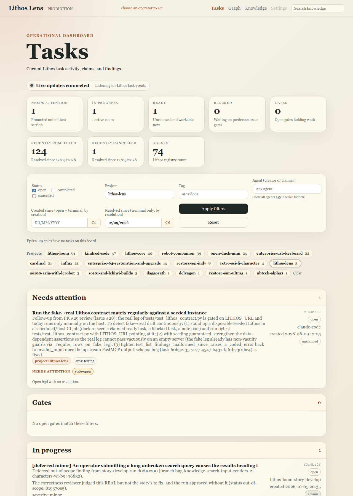

The screenshot shows the dashboard scoped to the `lithos-lens` project with only open tasks shown. The header and navigation are at the top, the live-updates indicator and summary cards below them, then the filter bar, the epic and project strips, and the first board sections.

---

## The Tasks dashboard

The dashboard is the operational view of Lithos tasks. Each open task sits in exactly one section, decided by its claims, its dependencies and whether something needs a human. Recently finished work is listed separately. The page updates live as agents claim, complete and post findings.

### Reading the board

**Live updates.** The strip under the heading shows the connection:

- **Live updates connected** · "Listening for Lithos task events" means the board is current.
- **Live updates paused** · "Reconnecting; polling fallback is active" means Lens has lost the event stream. It re-checks every couple of minutes until the stream returns.

**Summary cards.** The cards count what the board shows:

- **Needs attention**: "Promoted out of their section"
- **In progress**: active claims
- **Ready**: "Unclaimed and workable now"
- **Blocked**: "Waiting on predecessors or gates"
- **Gates**: "Open gates holding work"
- **Recently completed** and **Recently cancelled**: "Resolved since" a date
- **Agents**: the Lithos registry count

Click any card except Agents to show only that status and jump to its section. Your other filters stay applied.

**Sections, top to bottom:**

1. **Needs attention.** Tasks pulled out of their usual section because a human should look at them. Each row carries a **Needs attention** chip naming the reason and a one-line explanation. Most severe first:
   - **unsatisfiable**: a blocker was cancelled, so the task can never become ready
   - **cycle**: its dependencies loop back on themselves
   - **gate-waiting**: a human gate has waited too long (24 hours by default)
   - **PR needs a decision**: an automated pipeline has asked for a human, or a PR gate has kept failing
   - **claim-expiring**: a claim lapses soon (10 minutes by default)
   - **stale-open**: open for a long time with no resolution (7 days by default)
   - **ready-unclaimed**: ready but unclaimed for an hour, for tasks tagged with a `trigger:` tag

   An empty section reads "All systems healthy — 0 issues" (or "Nothing needs attention in this view." when the board is filtered).
2. **Gates.** Open gates (external waits such as a human decision, a timer, a CI run or a pull request), grouped by gate type with human gates first. A gate row shows:
   - how long it has been waiting
   - any pull-request state ("needs human · 2h")
   - for a timer gate, when it becomes ready ("ready in …", then "ready now")
   - a **blocks N tasks** list you can expand to see what is waiting on it
3. **In progress.** Tasks with an active claim.
4. **Ready.** Unclaimed tasks with nothing blocking them.
5. **Blocked.** Tasks waiting on unfinished predecessors or gates. **Blocked by** chips link to each blocker.
6. **Completed** and **Cancelled.** Tasks resolved since the "Resolved since" date.

Two further sections, **Claims unknown** and **Not classified**, appear only when Lens could not read part of Lithos's state. They hold the tasks it could not place.

**What a row shows.** Each row contains:

- the title, which opens the task
- the start of its description, with **… see more** to expand it in place
- the project chip and tag chips (click a tag to filter the board by it)
- the short id, a status badge, the creator, and when it was created or resolved
- a claim chip: **unclaimed**, **N claims** (each listed as aspect and agent), or **claims unknown**

Badges such as **N new findings** count up as agents post. When you have chosen an operator, a **⋯** menu on open rows offers **Cancel…**.

**Opening a task from the board.** Click a row to open its **side panel** on the right. The URL gains `?selected=<id>`, so the panel survives a reload and can be shared. The panel shows:

- the description and the parent breadcrumb
- what blocks the task and what it blocks
- active claims
- a link to its findings
- **Expand**, which opens the full [task detail](#task-detail) page

Press **Close** or Esc to dismiss the panel. Back and Forward re-open and close it.

**Live changes.**

- Claims update in place.
- Completed and cancelled rows move to their lists.
- New tasks appear at the top.
- Moments later the whole board redraws, so counts and sections settle.

When an operator is chosen, a **New task** link appears in the page header.

### Filtering what you see

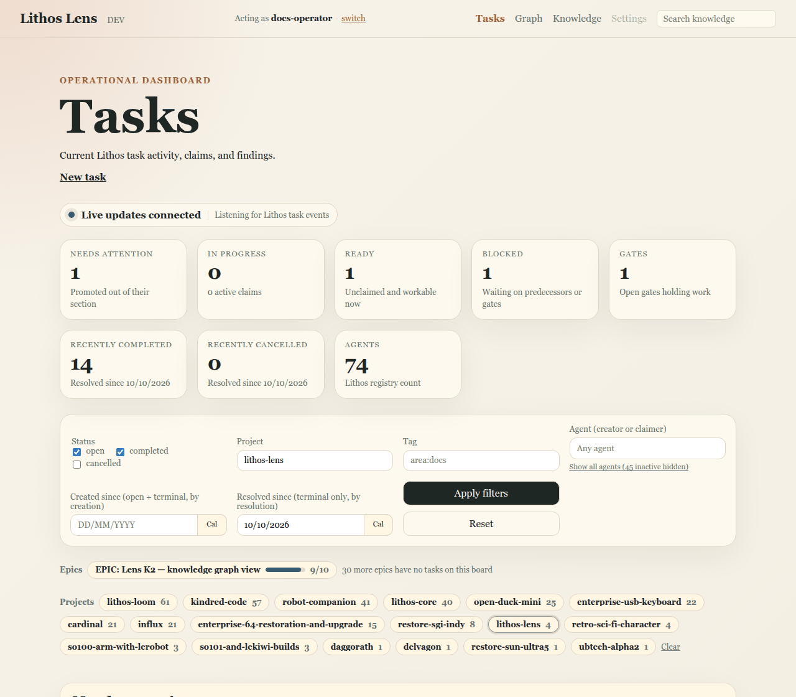

Use the filter bar to narrow the board, then press **Apply filters**. **Reset** clears everything.

- **Status**: tick **open**, **completed** and/or **cancelled**. All three are on by default.
- **Project**: type a project slug (suggestions are offered). Separate several with commas to see any of them.
- **Tag**: add a tag such as `area:docs`. Each tag you add narrows the board further. Active tags appear under **Scoped to**, where **×** removes one.
- **Agent (creator or claimer)**: show tasks an agent created or claimed. Inactive agents are hidden until you click **Show all agents (N inactive hidden)**.
- **Created since (open + terminal, by creation)**: only tasks created on or after a date. Empty by default.
- **Resolved since (terminal only, by resolution)**: how far back the Completed and Cancelled sections reach. It defaults to 30 days. Dates are DD/MM/YYYY; **Cal** opens a calendar.

Under the filter bar:

- The **Epics** strip shows a progress chip for each epic on the board ("done/total"). Click one to scope the board to that epic.
- The **Projects** strip lists projects with their open counts. Click one to add or remove it, or **Clear** to drop the project filter.

Every filter is held in the URL query string. A filtered board survives a refresh and can be bookmarked or shared.

---

## The dependency graph

**Graph** in the navigation opens `/tasks/graph`. It draws one project's or one epic's dependency structure from Lithos's task edges.

- **Without a scope**, the page shows **Pick a scope**: a list of **Projects** and a list of **Open epics**.
- **With a scope**, it shows `?project=<slug>` or `?epic=<id>`.
- **Defaults differ by scope.** A project graph hides resolved tasks. An epic graph shows its closed children too.

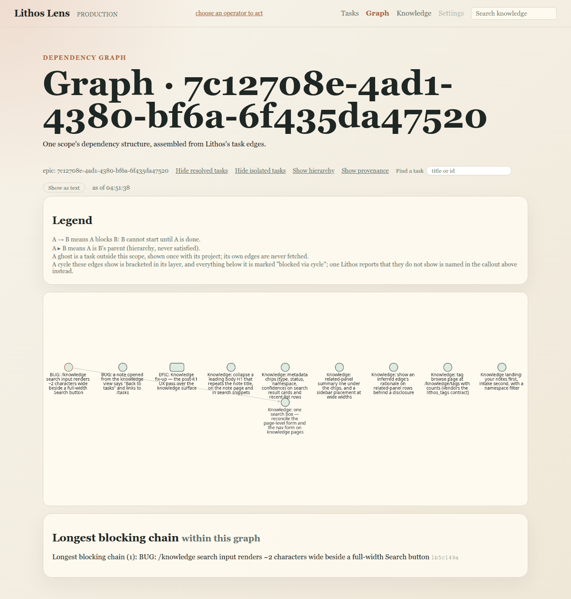

**Reading the canvas.**

- **Shape** is the task's type: an ellipse is a task, a rounded rectangle an epic, a diamond a gate.
- **Colour** is its status: amber is open, green completed, reddish-brown cancelled.
- A blocked node is darkened, and a claimed node pulses gently.
- **Ghosts** are tasks outside this scope that something inside depends on. They are drawn faded and dashed with their project on the label. Their own edges are not fetched.
- The **Legend** above the canvas lists only the edge kinds that appear:
  - "A → B means A blocks B: B cannot start until A is done."
  - "A ⇢ B means B waits on gate A."
  - "A ▸ B means A is B's parent (hierarchy, never satisfied)."
  - "A ⋯ B means B was discovered from A."
- **Cycles** are drawn in a dashed box labelled "cycle". Everything below a cycle is marked "blocked via cycle", and a callout at the top names each cycle.
- The **longest blocking chain** is drawn with thick accent-coloured edges and spelled out under **Longest blocking chain** below the canvas.

**The toolbar.**

- **Show resolved tasks** / **Hide resolved tasks** reloads the graph with or without finished tasks.
- **Show isolated tasks** / **Hide isolated tasks** shows or folds tasks with no edges.
- **Show hierarchy** and **Show provenance** overlay parent and discovered-from edges. They are off by default.
- **Find a task** matches a title or an id prefix. Pick a hit, or press Enter for the first one, to focus it.
- **Show as text** reveals the complete text version of the graph: the layers, the isolated tasks and the hierarchy. Everything the canvas shows is also there in words.
- **as of** gives the time of the oldest data on the page.

**Interacting with nodes.**

- **Click a node** to open its side panel and light its active ancestors and descendants. Everything else dims.
- The panel adds what completing the task would free ("Completing this frees N in this graph, M immediately") and whether the task is on the longest chain.
- **Double-click** a node to open its detail page.
- Drag to pan. The layout never moves under you.

When a task on the page changes, a **graph changed — refresh** pill appears. Click it to redraw.

If a scope is too large to draw (more than 300 tasks, ghosts included), the page says **Narrow your scope** and suggests picking a single epic or a smaller project.

---

## Task detail

A task's detail page (`/tasks/<id>`) shows everything Lens knows about one task. You can reach it from:

- **Expand** in a side panel
- a double-click on a graph node
- any task link: a breadcrumb, a blocker line or a child row
- Ctrl/Cmd-clicking a board row

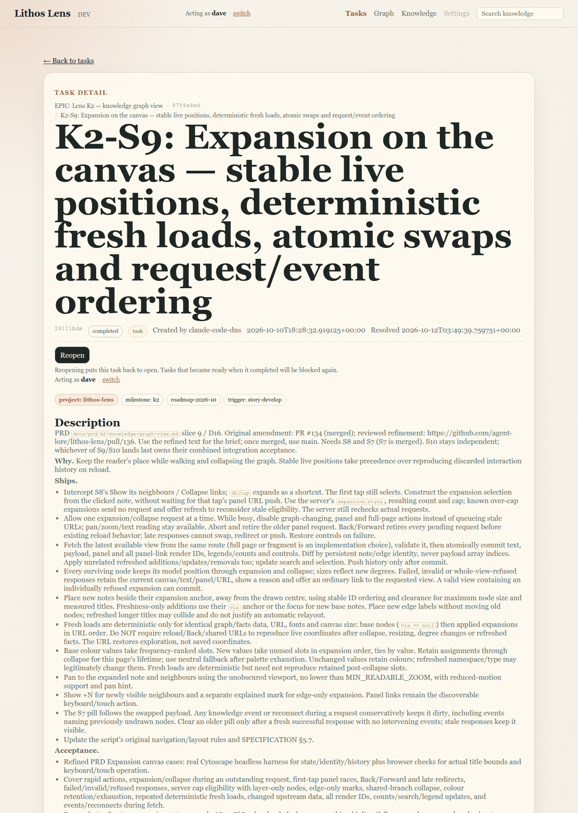

**Top of the page.**

- **← Back to tasks**, the **Task detail** eyebrow, and the parent breadcrumb (each ancestor linked, with its short id).
- The title.
- A meta line: short id (hover for the full id), status and type badges, gate type for gates, who created it and when, when it was resolved, and its outcome.
- The write actions that apply when you have chosen an operator: **Reopen** on this completed task, **Cancel…** on an open one, and others described under [Acting as an operator](#acting-as-an-operator).
- The tag chips, each linking to the board filtered by that tag.

**Sections, in order:**

- **Description**: the full Markdown description, never truncated.
- **Nearby graph**: a small graph of "blockers two hops up, dependents one down", plus the parent epic. The task itself is ringed.
  - Drag to pan and scroll to zoom.
  - Double-click a neighbour to open its page.
  - **Open this task in the project graph** goes to the full graph.
- **Blocked by**, or **Dependencies** once every predecessor has finished. One line per predecessor with its status, plus:
  - **satisfied** for a completed predecessor
  - **unsatisfiable** for a cancelled one
  - **Show its blockers**, which expands the chain one level in place, up to five levels. Beyond that, open a blocker's own page to keep walking.
- **Blocks:** the tasks waiting directly on this one, or "Nothing depends on this task."
- **Provenance**: the task this was "Discovered while working on", and any "Spawned follow-ons".
- **Children** (for epics): a table of id, task, type and status.
- **Metadata**: the task's metadata as key/value pairs.
- **Active Claims**: aspect, agent and expiry, or "No active claims."
- **Findings**: the [finding timeline](#finding-timeline).

Long lists show the first 25 entries and say how many more there are. The page refreshes itself when the task changes in Lithos.

---

## Finding timeline

Findings are the notes agents post while working a task: progress, results, review outcomes, pull-request links. The timeline is where you see how a task actually went.

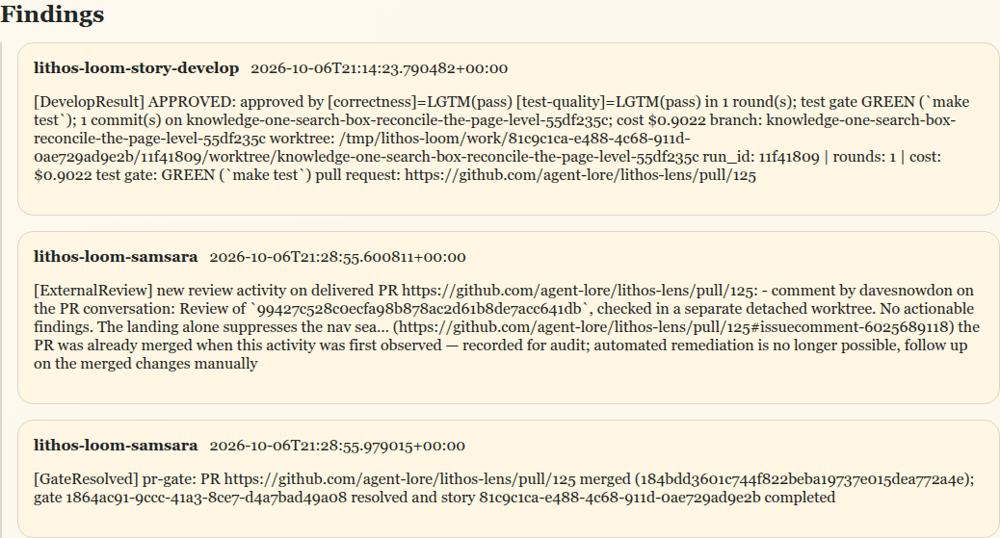

- Open a task's detail page and scroll to **Findings**, or follow the **N findings** link in a side panel, which jumps straight there.
- Findings are listed **oldest first**, all of them, with no paging.
- Each finding shows the agent that posted it, the time and the summary text.
- A finding posted when someone reopened the task carries a **reopen report** badge.
- If a finding produced a knowledge note, it links to that note by title. Follow the link to read the note in the [note renderer](#knowledge-notes). Its back link returns you to this task.
- A task with none reads "No findings have been posted for this task."

---

## Acting as an operator

Lens is read-only until you choose an **operator identity**. Click **choose an operator to act** in the header, or go to `/operator`.

- Enter a name under **Act as** and press **Set identity**: lowercase letters, digits and dashes, starting with a letter or digit, at most 63 characters.
- The identity is an **attribution label**: it is the name your writes are recorded under in Lithos.
- It is **not** authentication. Lens has no authentication or authorization: anyone who can reach its port can act. It is built for a single operator on a trusted local network, and the page says so.
- Lens refuses its own service agent's id, and any id that already belongs to an agent.
- Once set, the header shows "Acting as **you** · switch". Use **switch** to change identity.

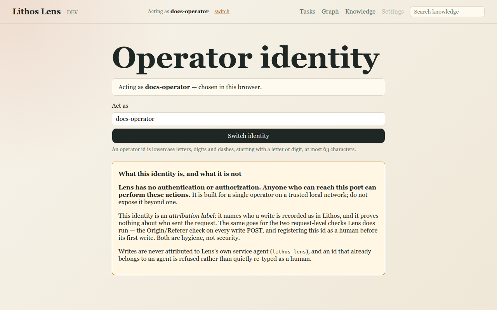

With an identity set, these write actions appear where they apply. Each one tells you what it will do before anything is written:

- **New task** (dashboard header) and **Add child** (an open epic's detail page) open the form **New task, epic or gate**.
  - Fields: **Title**, **Type**, **Description** (Markdown), **Project**, **Tags** (one per line), **Parent**, **Blocked by** (task ids that must finish first), and for gates a **Gate type** (human, external task or timer) with **Ready at** for timers.
  - Press **Create**. Submitting twice still creates only one task.
- **Cancel…** (open tasks: the detail page, and the **⋯** menu on board rows) opens **Cancel this task?**, which shows what cancelling would do:
  - how many tasks it strands, directly and behind them, and which ones
  - whose claims it releases
  - that its children are **not** cancelled with it
  - for a gate, that its waiters become unsatisfiable

  Give an optional **Reason**, then press **Cancel task**, or **Keep it** to back out.
- **Reopen** (completed or cancelled tasks, on the detail page) has no separate confirmation page. Its line tells you the consequence first: "Tasks that became ready when it completed will be blocked again." (or, for a cancelled task, that its dependents stop being permanently blocked).
- **Add a dependency** (an open task's detail page): choose a sentence ("This task is blocked by ▁", "This task blocks ▁", or on a gate "▁ waits on this gate"), enter the **Other task**, and press **Check relation…**.
  - The confirmation page restates the relation with both titles and what it means for readiness.
  - Confirm with **Add this dependency**, or back out with **Don't add it**.
  - Lens does not remove dependencies.
- **Complete** (open human or external-task gates, on board rows, panels and detail pages) releases whatever waits on the gate. Add an optional **Note**.
- **Proceed anyway…** (timer, CI, PR and other gates that something else resolves) opens **Proceed anyway?**. It explains what would otherwise resolve the gate and what completing it now would release. Press **Complete anyway** or **Keep waiting**.

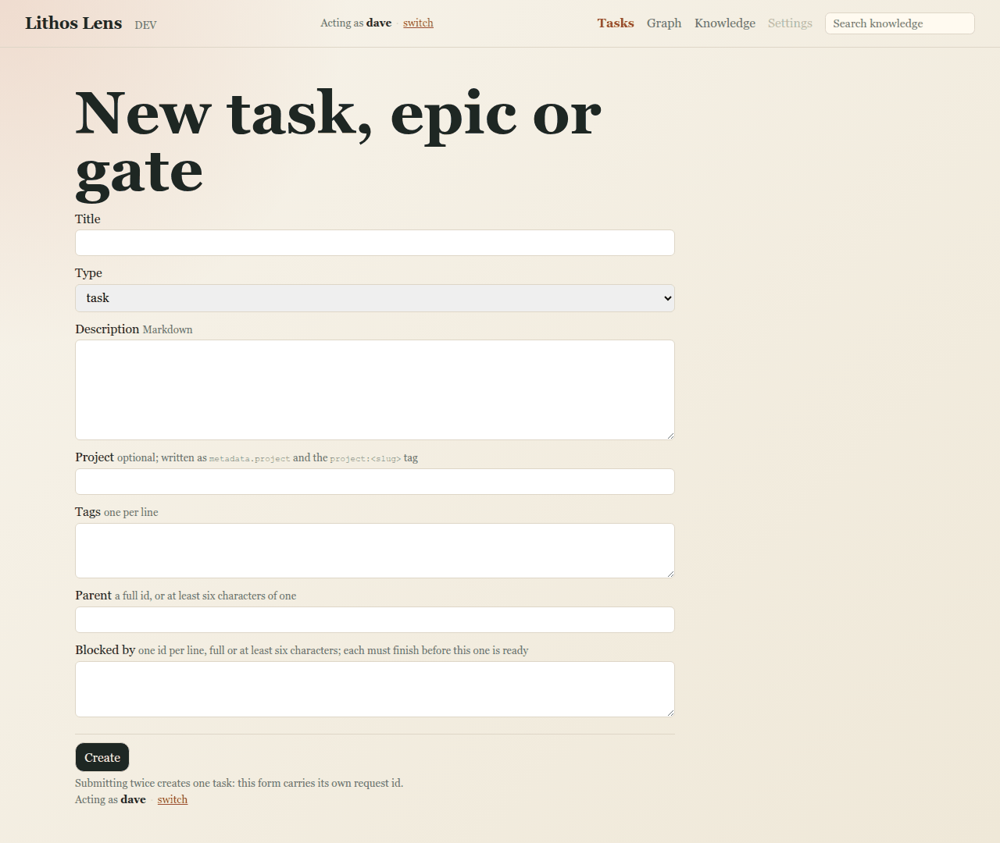

**After a write**, a receipt appears once at the top of the page you land on. Examples:

- "✓ Completed gate …" with what it unblocked
- "↺ Reopened …" with what it re-blocked
- "✕ Cancelled …"
- "+ Created …"
- "+ Added dependency …"

**If Lithos refuses**, Lens shows a **Write refused** page that starts "Nothing was changed." and explains why, for example "This dependency would create a cycle.", along with links back to the task or the board. If Lens never heard back, the page says **Outcome unknown**: the action may or may not have applied, so check the task before trying again.

If you try a write with no identity set, Lens takes you to `/operator` first. The write is not replayed, so repeat it afterwards.

---

## Knowledge

**Knowledge** in the navigation opens `/knowledge`, the knowledge landing, headed **Search notes**.

- **Search box.** Type into it and press **Search**. On this page the header's search box is hidden, so there is only one.
- **Namespace filter.** A row under the box with **all** and the most common namespaces with their counts. Pick one to search only that part of the knowledge base.
- **Before you search**, the page shows:
  - **Browse tags** · **Browse the graph** · **N unresolved contradictions**. The last link opens the contradictions queue in the [knowledge graph](#the-knowledge-graph).
  - **Your notes**: the most recently updated notes that are not intake.
  - **Recent intake**: articles, papers and digests ingested into Lithos, kept apart so they do not bury your own notes.

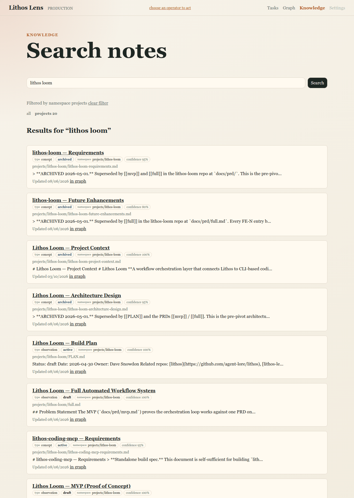

**Search results.** Each result card shows:

- the note's title (opens the note)
- chips for its type, status, namespace and confidence (an **archived** or **quarantined** status stands out)
- its path and a plain-text snippet
- when it was last updated
- **in graph**, which opens the note in the knowledge graph

The line above the results names any active filter, with **clear filter** to remove it.

**Tags.** **Browse tags** opens `/knowledge/tags`, every tag in the knowledge base with its note count, most notes first.

- The row of tag families (`project:`, `source:`, `arxiv-id:` …) narrows the list to one family.
- **Filter tags** keeps only tags containing some text.
- Click a tag to see its notes on the landing page.

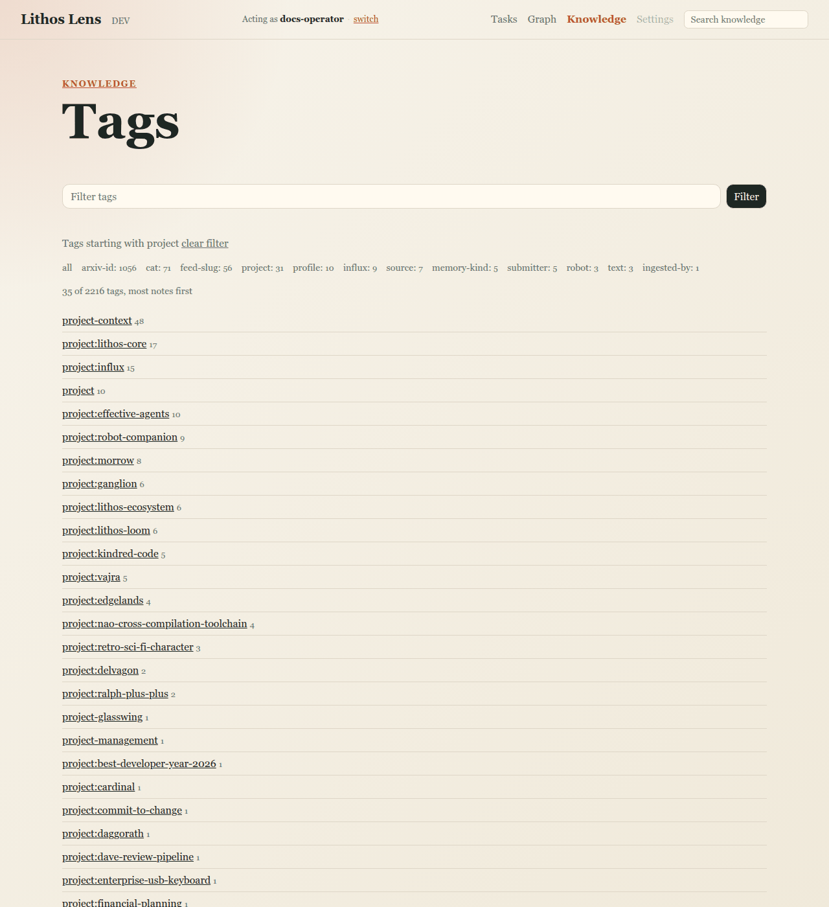

---

## Knowledge notes

A note page (`/note/<id>`) renders one knowledge note. You arrive by:

- following a finding's note link
- a search result or a tag listing
- a link inside another note

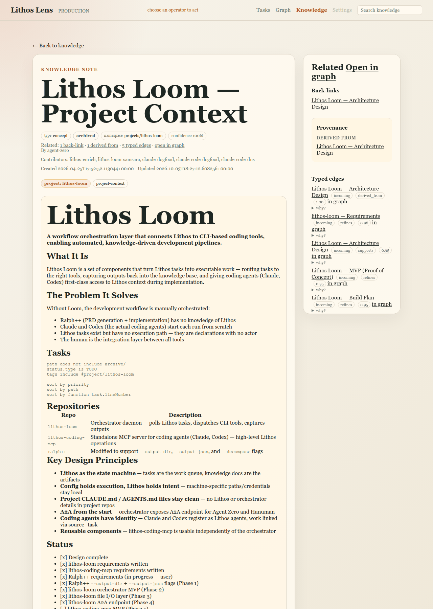

**The note's header**, under the **Knowledge note** eyebrow:

- the title and chips for type, status, namespace and confidence
- a **Related:** summary line ("1 back-link · 1 derived from · 5 typed edges · open in graph"). Each count jumps to its group.
- the author, the contributors, and the created and updated times
- the note's tags as chips (click one to list its notes)

**The body** is rendered Markdown, including tables and code. If the body starts with a heading that repeats the title, the heading is hidden.

**Wiki-links** (`[[like this]]`) resolve when you click them:

- One confident match opens the note.
- Several matches open **Which "…"?** so you can pick one.
- No match opens **Unresolved link**, with a link to search for the text instead.

**The Related panel** sits beside the note on a wide screen, or below it on a narrow one. **Open in graph** opens the note in the knowledge graph. The panel lists:

- **Outgoing links** and **Back-links**: wiki-links to and from this note
- **Provenance**: what the note was derived from, and what was derived from it
- **Typed edges**: the relations Lithos records between this note and others. Each row shows the other note, direction and type (such as `supports` or `refines`), weight, and **in graph** (opens that edge in the graph).
  - **why?** opens the edge's provenance ("inferred by …", "reinforced by citation", "declared in frontmatter"). For an inferred edge it also shows the model's one-sentence rationale and confidence.

If this note is one side of an unresolved contradiction, a banner above the body says "This note is contradicted by … — view", linking to the contradiction in the graph.

**The back link** at the top returns you to where you came from:

- "← Back to <task>" when you followed a finding
- "← Back to search results" or "← Back to notes tagged …" from the knowledge pages
- otherwise "← Back to knowledge"

---

## The knowledge graph

Lithos records **typed edges** between notes: one note supports, refines, depends on, contradicts or is derived from another. The knowledge graph (`/knowledge/graph`) draws them.

> **Note:** the header's **Graph** link opens the *task* graph. The knowledge graph is reached from the Knowledge pages.

Ways in:

- **Browse the graph** on the knowledge landing
- **Open in graph** on a note
- **in graph** on a search result or a typed edge
- the contradiction banner on a note

**Choosing what to draw.** The knowledge base is too large to draw whole, so there is no unscoped picture. With no scope, the page lists **Edge types** and **Namespaces** with their edge counts and the unresolved-contradictions count; you can also type a scope and press **Draw**. A graph is one of:

- **Graph around a note** (`?focus=<id>`): one note and its neighbours, one hop out by default or two at **depth 2**. Its wiki-links and provenance are drawn too.
- **Graph by scope** (`?type=…` and/or `?namespace=…`): every edge of one type or in one namespace.
- **The contradictions queue** (`?type=contradicts`): every contradiction, unresolved first.

A scope that would draw too many notes (250 around a note, 500 by scope) is refused under **Narrow your scope**. The page states the count and offers a smaller depth or a higher minimum weight that would fit. Lens never draws a silently truncated graph.

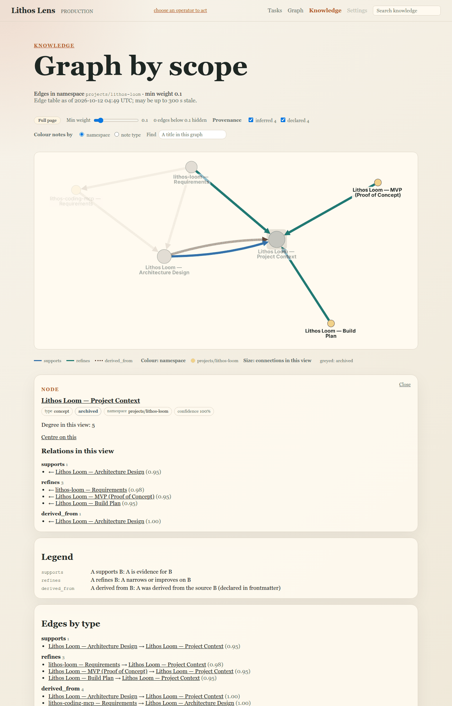

**The canvas.**

- **Edges.** Each edge type has its own colour. Directed relations have arrowheads; `related_to`, `analogy_to` and `contradicts` do not. A heavier line is a stronger edge.
  - `derived_from` edges are dotted.
  - Wiki-links are thin grey lines.
  - An unresolved contradiction is red and dashed. A resolved one is muted and labelled with its resolution.
- **Notes.** A note's size is its number of connections in this view. Its colour is its namespace, or its note type if you switch.
- **Status marks.** An archived note is greyed. A quarantined note has a red ring. A note that no longer exists is drawn dashed with its short id ("note not found").
- The **key** under the canvas explains every colour and mark on screen.
- Click a note or an edge to light it and its neighbours and open its panel. Click the background to clear. Drag to pan, scroll to zoom.

**The toolbar.**

- **Min weight**: hide edges weaker than the slider. The count of hidden edges is shown beside it.
- **Provenance**: show or hide edges by how they came to exist: **inferred** by a model, **reinforced** by citation, **declared** by an author, or **other**.
- **Depth** (graph around a note): **depth 1** or **depth 2**, with the number of notes the other depth would draw.
- **Colour notes by**: **namespace** or **note type**.
- **Find**: highlight notes whose title matches.
- **Full page**: see below.

Every control except Find and Full page reloads the view, so the text below the canvas always matches the picture.

**Node panel.** It shows:

- the note's title (opens the note), its chips, and **Degree in this view**
- **Centre on this**, which starts a new graph around this note
- **Relations in this view**, grouped by type, each linking to its edge's panel

**Edge panel.** It shows:

- the relation as a sentence ("A supports B", "A and B contradict each other")
- its type, weight, namespace and provenance
- the **Evidence**: for an inferred edge, the rationale, the model and its confidence
- both notes as cards, side by side for a contradiction

For a contradiction the panel leads with its state, unresolved or how it was resolved. Resolving contradictions is not yet a Lens action.

### Expanding a note in place

In a graph around a note, you can keep walking without starting over:

- **Expand.** Double-click a note, or use **Show its neighbours — adds N notes and M edges** in its panel. The note's edges and neighbours are added beside it. **Nothing already on screen moves**, and the view pans to show what arrived.
- **Badges.** A note with neighbours not yet drawn shows **+N**. A note that would only add edges between notes already drawn shows **↔**.
- **Collapse.** **Collapse** in an expanded note's panel removes that expansion and any expansions that followed from it. **Back** undoes the last expansion.
- **The URL records your expansions.** A reload or a shared link draws the same set. The scope line under the heading lists them as "expanded: …", each with a **remove** link.
- **Refused expansions.** An expansion that would go over the 250-note cap is refused on its own and listed under **Not shown**. The rest of your view stays.

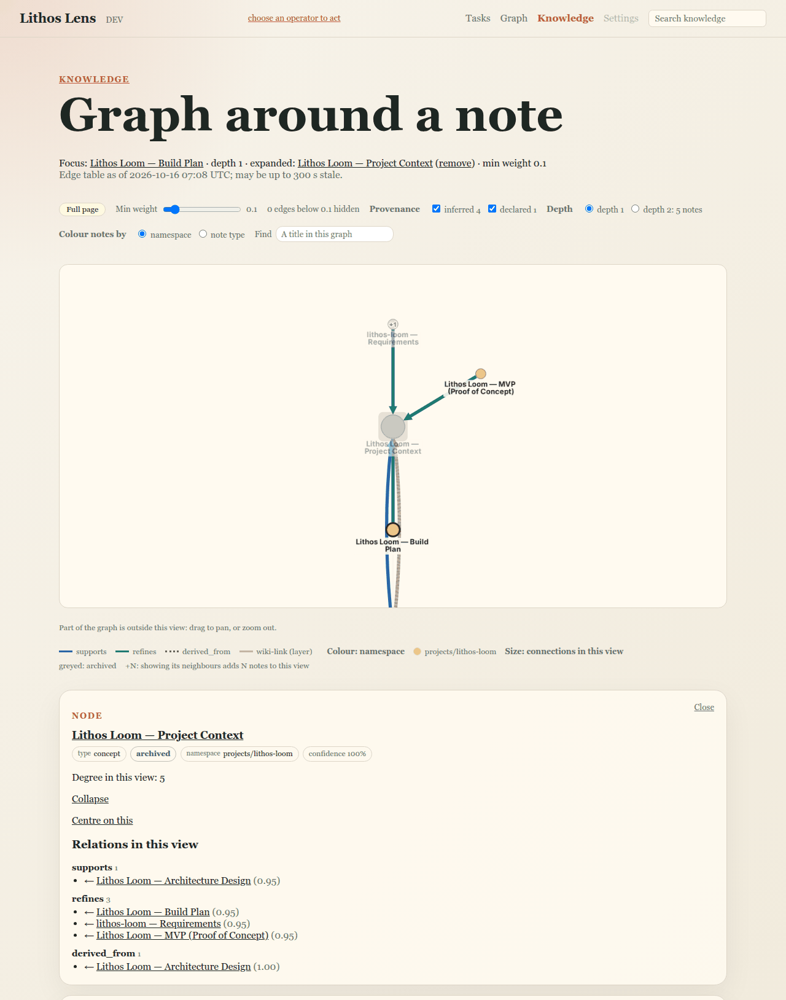

### Full page and the text view

**Full page** in the toolbar makes the canvas fill the window below the header, without reloading or moving a note. Switch back with **Exit full page**. The setting is kept in the URL (`&canvas=full`), so links and reloads stay in full page.

- The toolbar runs along the top of the canvas. The **Key** sits behind a button in the bottom-left corner.
- On a narrow screen the toolbar folds behind **Controls**.
- Panels open as a drawer on the right, or as a sheet from the bottom on a narrow screen. The drawer scrolls on its own: the mouse wheel zooms the canvas but scrolls the panel.
- **Close** or Esc closes the panel. Esc never leaves full page.
- **Text view** jumps to the text below the canvas.

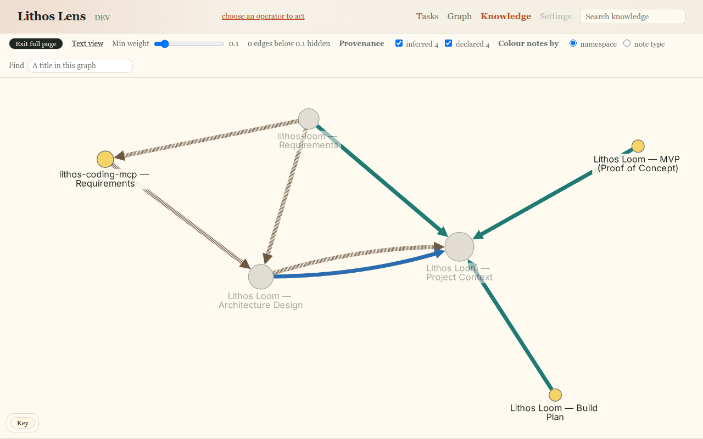

**The text below the canvas** is the complete page. It works without JavaScript and lists everything the canvas draws:

- the scope line and when the edge table was read ("may be up to 300 s stale")
- **Legend**
- **Focus note**
- **Neighbours by relation**, or **Edges by type**, or **Contradictions queue**
- **Wiki-links and provenance**
- **Edges to missing notes**
- **Not shown**: what the filters hid, with links to show it

While the page is open, a **graph changed — refresh** pill appears in the toolbar if a note or edge on it changes in Lithos. The graph never redraws by itself; click the pill when you are ready.

---

## When Lithos is unavailable

Lens stays up when it cannot reach Lithos and says so instead of failing.

- **The dashboard** shows "**Lithos is offline or degraded.** Task data is unavailable. Lens is running and will retry on refresh." It adds four tiles giving the state of **Lens**, **Lithos**, **Events** and **LLM**. The page does not refresh itself in this state: once Lithos is back, reload.
- **Other pages** carry their own messages:
  - task pages: "Task unavailable"
  - notes: "Lithos is offline or degraded. The note cannot be loaded."
  - the knowledge graph: "The knowledge graph is unavailable."
- **Partial failures** are reported section by section ("Some task data could not be loaded."), and the rest of the page still renders.

If you see this, check that the Lithos server is running and that Lens is pointed at it, then reload.

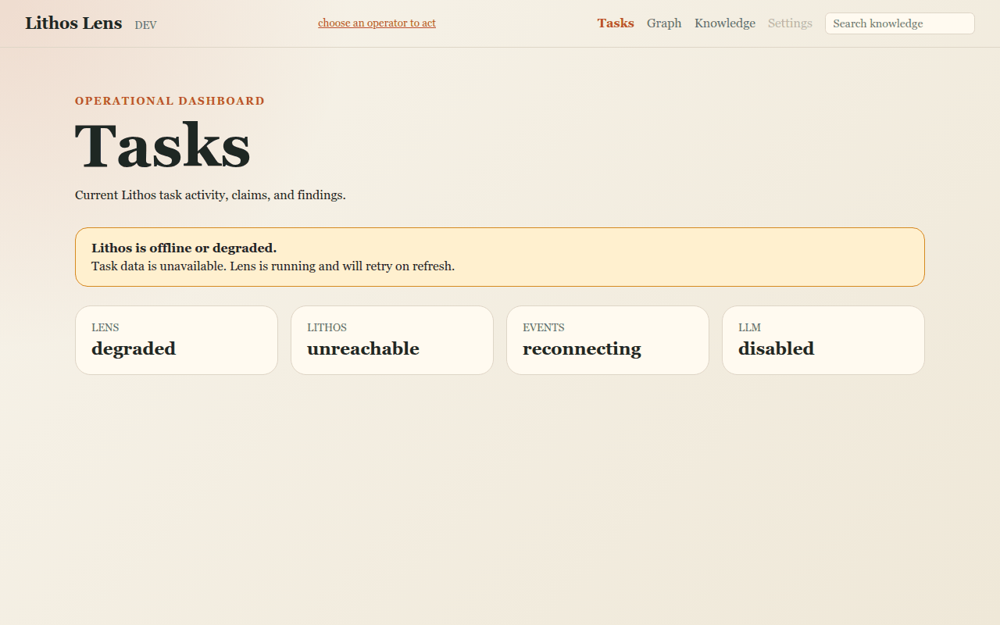
