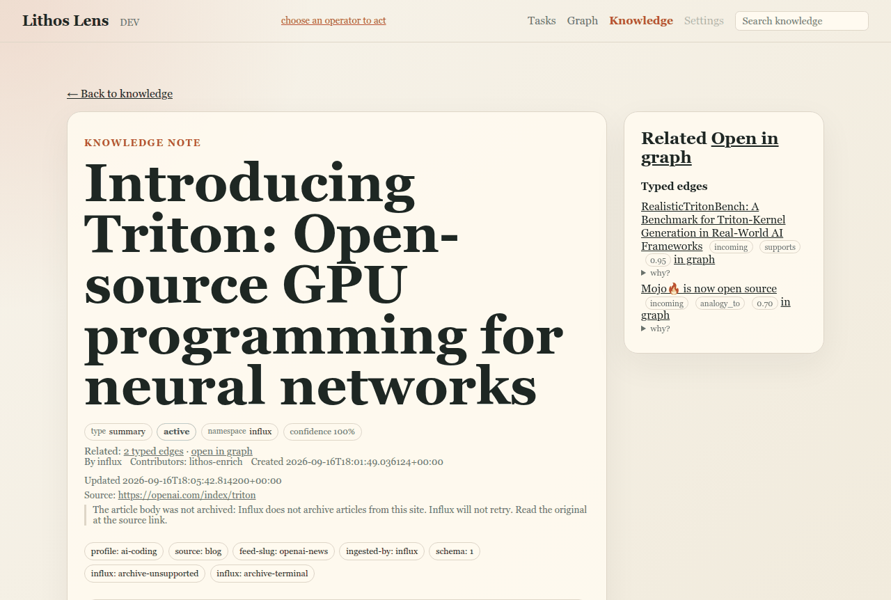

# Lithos Lens User Manual

Lithos Lens is a web window onto **Lithos**: the tasks agents are working on, the dependency graph between them, the findings they post, and the knowledge notes and the typed edges between those notes. It updates live as Lithos emits events. Reading never changes anything; a small set of curated write actions is available once you choose an operator identity, and each shows its consequences before anything is written.

_This file is regenerated by the `/regen-manual` slash command. Do not edit by hand — your changes will be overwritten on the next regeneration._

## Contents

- [Getting around](#getting-around)
- [The Tasks dashboard](#the-tasks-dashboard)
- [The dependency graph](#the-dependency-graph)
- [Task detail](#task-detail)
- [Finding timeline](#finding-timeline)
- [Acting as an operator](#acting-as-an-operator)
- [Knowledge](#knowledge)
- [Knowledge notes](#knowledge-notes)
- [The knowledge graph](#the-knowledge-graph)
- [When Lithos is unavailable](#when-lithos-is-unavailable)

---

## Getting around

Every page shares one header. On the left is **Lithos Lens** with the environment label (here `DEV`). In the middle is the operator indicator: **choose an operator to act** when no identity is set, or **Acting as _name_ · switch** when one is. On the right are the main sections — **Tasks**, **Graph** (the task dependency graph) and **Knowledge** — plus a **Search knowledge** box that searches notes from anywhere. **Settings** is shown greyed out: it is a placeholder and does nothing yet. The Tasks dashboard is the home page: `/` and `/tasks` are the same view.

The screenshot above is the Tasks dashboard scoped to one project with only open tasks shown, the view most operators keep open.

---

## The Tasks dashboard

The dashboard is the operational view of Lithos tasks. It sorts every task in scope into sections by what it needs next, adds who has claimed it and any reason it wants your attention, and updates in place as Lithos reports task, claim and finding events.

### Reading the board

1. **Live updates.** The pill under the page title reads **Live updates connected** while Lens is listening for Lithos events. Rows, counts and sections then change in place as agents create, claim, complete or cancel tasks; you do not need to refresh.
2. **Summary cards.** The first row counts the open work in scope: **Needs attention** (promoted out of their section), **In progress** (active claims), **Ready** (unclaimed and workable now), **Blocked** (waiting on predecessors or gates) and **Gates** (open gates holding work). The second row counts **Recently completed** and **Recently cancelled** since the resolved-since date, and **Agents** in the Lithos registry.
3. **Epics and Projects strips.** Below the filters, the **Epics** strip lists the epics with tasks on this board, and the **Projects** strip shows every project with its open-task count. Click a project chip to scope the board to it; the active one is outlined, and **Clear** removes it.
4. **Sections.** Open tasks appear in **Needs attention**, **Gates**, **In progress**, **Ready** and **Blocked**, each with its count; completed and cancelled tasks get their own sections when you include those statuses. Each task appears in exactly one section.
5. **Needs attention.** A task is promoted here, and removed from the section it would otherwise occupy, when it fires one of the attention rules: a blocker or gate was cancelled so it can never become ready (`unsatisfiable`); its blocking chain forms a `cycle`; a human gate has waited too long (`gate-waiting`); a PR gate needs a human decision (`pr-needs-decision`); a claim is about to lapse (`claim-expiring`); a workable task has stayed open too long (`stale-open`); or a ready task that a fleet should have picked up has not been (`ready-unclaimed`). Each rule that fired shows as a chip, with a line explaining it — for example "Open 67d with no resolution."
6. **A task row.** Each row shows the title, the start of its description, its tag chips (the project tag is highlighted), and on the right its short id, status, creating agent, creation time and claim state (**unclaimed**, or the agent holding the claim). Click a row to open the side panel over the right edge of the board; follow the title link to open the full [task detail](#task-detail) page.

### Filtering what you see

1. Tick the **Status** boxes — **open**, **completed**, **cancelled** — to choose which tasks the board holds. The screenshot shows only completed tasks for one project.
2. Type a **Project** to scope the board to one project (or click a chip in the Projects strip).
3. Type a **Tag**, such as `area:docs`, to keep only tasks carrying it. Each tag you add becomes a chip you can remove.
4. Choose an **Agent** to see only tasks that agent created or has claimed. Inactive agents are hidden from the list until you click **Show all agents**.
5. Set **Created since** to limit tasks by creation date, and **Resolved since** to limit completed and cancelled tasks by when they were resolved. Dates are `DD/MM/YYYY`; **Cal** opens a date picker. Resolved since defaults to 30 days ago.
6. Click **Apply filters**, or **Reset** to return to the defaults.

The whole filter is held in the page address. A filtered board survives a refresh, and you can bookmark it or send the link to someone else to show them the same view.

---

## The dependency graph

**Graph** in the header opens `/tasks/graph`, which draws one project's or one epic's dependency structure from the edges between Lithos tasks. Opened without a scope, the page asks you to **Pick a scope** from its lists of projects and open epics (or link straight to `?project=` or `?epic=`); the page title then names the scope. The **Legend** explains the marks: `A → B` means A blocks B, so B cannot start until A is done (a task waiting on a gate is listed as *waits on gate* in the text view); `A ▸ B` means A is B's parent; `A ⋯ B` means B was discovered from A. A **ghost** — a dashed node with its project named under the title — is a task outside this scope that a task inside it depends on; its own edges are never fetched.

1. Use the toolbar to change what is drawn. **Show resolved tasks** adds completed and cancelled tasks; **Show isolated tasks** adds tasks with no edges; **Show hierarchy** draws parent links; **Show provenance** draws discovered-from links. The **as of** time says when the graph was read.
2. Type in **Find a task** (a title or an id) to locate a task on the canvas.
3. Click **Show as text** for the complete view as a list. When a graph is larger than the canvas can draw at a readable size, the canvas shows part of it — drag to pan — and the text view still holds every task and edge.
4. A **cycle** among the drawn edges is bracketed in its layer, and every task below it is marked "blocked via cycle". If Lithos reports a cycle the drawn edges do not show, a callout above the graph names it.
5. **Longest blocking chain** under the canvas lists the longest run of tasks that must finish one after another, with each task's short id. In the screenshot, an influx task blocks a lithos-core task, which appears as a ghost.

---

## Task detail

Click a task's title — on the dashboard, in the side panel, or in a graph — to open its detail page at `/tasks/<id>`. This is everything Lens knows about one task.

1. The breadcrumb at the top places the task under its epic or parent (each with its short id); click one to go up.
2. Under the title you see the short id, the status and type chips, the creating agent, and the created and resolved times.
3. If you have chosen an operator identity, the write actions for this task sit here. A completed task offers **Reopen**; an open task offers **Cancel…** and **Check relation…**. See [Acting as an operator](#acting-as-an-operator).
4. The tag chips follow, then the **Description**, rendered from Markdown.
5. **Dependencies** lists what this task waits on and what waits on it, with a small graph of its nearby neighbourhood; expand a blocker to walk further up its chain.
6. **Metadata** shows the task's metadata fields, **Active Claims** shows which agent holds it and until when, and **Findings** shows its [finding timeline](#finding-timeline).
7. **← Back to tasks** returns you to the dashboard with your filters intact.

---

## Finding timeline

Findings are the notes agents post against a task as they work: progress, review results, decisions, failures, the hand-off when work is done. The timeline is the place to read a task's story — what happened, who did it, and why it ended the way it did.

1. Open a task's detail page and scroll to **Findings**. It is read when the page loads; refresh to pick up findings posted since.
2. Findings are listed oldest first. Each shows the posting agent, its timestamp and the finding's text.
3. When a finding cites a knowledge note, it links to that note; follow the link to open it in the [note view](#knowledge-notes).

---

## Acting as an operator

Lens offers a few write actions, and only once you choose an operator identity. Click **choose an operator to act** in the header (or open `/operator`), enter a name under **Act as** and click **Set identity**. An operator id is lowercase letters, digits and dashes, starting with a letter or digit, at most 63 characters. The identity is an **attribution label**: it names who a write is recorded as in Lithos, and proves nothing about who sent the request. Lens has no authentication: it is built for a single operator on a trusted local network, and anyone who can reach it can act. Writes are never attributed to Lens's own service agent, and a name that already belongs to an agent is refused. Use **switch** in the header to change identity.

Each write action opens a confirmation page that states its consequences before anything is written, and nothing changes until you confirm:

- **New task, epic or gate.** `/tasks/new` takes a title, a type (task, epic or gate), a Markdown description, an optional project (written as `metadata.project` and the `project:<slug>` tag), tags one per line, an optional parent, and the tasks it is blocked by. Submitting it twice creates one task.
- **Cancel…** on an open task. The confirmation names what cancelling strands — the open tasks that depend on it — and whether an agent holds a claim. You can give a reason; it goes into the event stream only, not onto the task. Choose **Cancel task** or **Keep it**.
- **Reopen** on a completed task puts it back to open. Tasks that became ready when it completed will be blocked again.
- **Check relation…** adds a dependency. Choose whether this task is blocked by, or blocks, another task, and give the other task's id (in full, or at least six characters). Lens shows the relation with both titles and what it means for readiness before anything is written.
- **Proceed anyway…** on an open gate. The confirmation says what would otherwise resolve the gate (for example, a timer's due time) and which waiting tasks completing it releases. You can add a note; without one, the gate records that you completed it early via Lens. Choose **Complete anyway** or **Keep waiting**.

---

## Knowledge

**Knowledge** in the header opens `/knowledge`. With no query, it shows **Browse tags**, **Browse the graph**, the count of unresolved contradictions between notes, and two recency lists: **Your notes** first, then **Recent intake** from ingestion pipelines such as Influx. Type in the search box and click **Search** to search notes; the namespace links under the box narrow the search to one part of the knowledge base, and **clear filter** removes the namespace.

1. Each result card shows the note's title, its chips (type, status, namespace, confidence), its path, a snippet of its text and when it was last updated. Archived notes say so in their status chip.
2. Click a title to open the [note](#knowledge-notes); click **in graph** to open the [knowledge graph](#the-knowledge-graph) centred on that note.
3. **Browse tags** opens `/knowledge/tags`, every tag in the knowledge base with how many notes carry it, most notes first. Type in **Filter tags** to narrow the list, or click a prefix such as `project:` or `source:` to show only the tags that start with it. Click a tag to list the notes carrying it.

---

## Knowledge notes

A note opens at `/note/<id>` — from a search result, a tag listing, a finding's link, a node in the knowledge graph, or a wiki link in another note. Lens renders the note's Markdown; links to other notes work, and links that could be unsafe are dropped.

1. The header gives the note's title and its chips: type, status (quarantined notes are highlighted), namespace, access scope when the note is not shared, and confidence.
2. **Related** summarises its connections — back-links and typed edges — and **open in graph** opens the knowledge graph centred on this note. The author, contributors and created and updated times follow.
3. The body follows, with a one-line summary above it when the note has one.
4. The **Related** panel beside the note lists back-links (other notes that link here) and typed edges, each with its direction, type and weight. Click **why?** on an inferred edge to see the model's rationale, or **in graph** to open that edge in the graph.
5. The back link above the note returns you where you came from, and says so: **← Back to search results**, **← Back to notes tagged …**, **← Back to knowledge**, or the title of the task whose finding you followed.

Notes ingested from the web carry a link to the original:

6. **Source** links to the article or page the note was made from. Only an ordinary web address is a link; any other value is shown as plain text.
7. Some sites cannot be archived — Influx does not fetch some domains, some sites block it, and some links are not articles at all. For such a note the article body is missing, and Lens explains why under the source line: the reason Influx recorded, that Influx will not retry, and that the original is at the source link.

---

## The knowledge graph

Notes in Lithos are connected by typed edges — `supports`, `refines`, `derived_from`, `contradicts` and more — some declared by their authors and some inferred. `/knowledge/graph` draws them. Reach it from **Browse the graph** on the knowledge page, **open in graph** on a note, or **in graph** on a search result or edge. Without a scope, the page offers a scope picker listing namespaces and edge types with their edge counts, read from a cached copy of the edge table (the page says how old it is). Choose a namespace or type for **Graph by scope**, or centre on a note for **Graph around a note**.

1. **Toolbar.** Drag **Min weight** to hide weak edges (the count hidden is shown beside it). Tick **Provenance** boxes to show inferred and declared edges. **Colour notes by** namespace or note type. Type in **Find** to locate a note by title.
2. **Canvas and key.** Notes are circles sized by their connections in this view; archived notes are greyed. Edges are drawn by type, with arrowheads showing direction. The key under the canvas names the line styles and colours.
3. **Node panel.** Click a note to select it. The panel shows its chips, its **Degree in this view**, **Centre on this** (to redraw the graph around it), and **Relations in this view** grouped by type. Click a related note's arrow to open the edge.
4. **Edge panel.** Selecting an edge shows its source and target, type, weight, namespace, provenance (with the inferring agent and its rationale for an inferred edge), and when it was created and updated.
5. Below the canvas, **Legend** explains each edge type in the view, **Edges by type** lists every edge as text, and **Not shown** says how many edges the weight and provenance filters are hiding.

6. **Expansion.** In **Graph around a note**, choose a depth of 1 or 2. Select another note and click **Show its neighbours** to add its own neighbours to the view (the panel says how many notes and edges that adds); a **+N** mark on a note shows how many neighbours expanding it would add. **Collapse** removes them again, and the page header lists the notes you have expanded, each with a **remove** link.

Click **Full page** to give the canvas the whole window. The toolbar stays across the top, and the node or edge panel opens as a drawer on the right; **Key** in the corner shows the key, and **Text view** jumps to the text listing. **Exit full page** returns to the normal layout. If the knowledge base changes while you are looking, a **graph changed — refresh** pill appears; click it to redraw with the new edges.

---

## When Lithos is unavailable

Lens keeps running when it cannot reach Lithos. Instead of an error, the task pages show a **Lithos is offline or degraded** banner saying task data is unavailable, and the dashboard shows four status cards: **Lens** (degraded), **Lithos** (unreachable), **Events** (reconnecting) and **LLM**. Lens retries on every refresh and reconnects live updates on its own once Lithos is back. If the banner persists, check that the Lithos server is running and that Lens is configured with its address.

